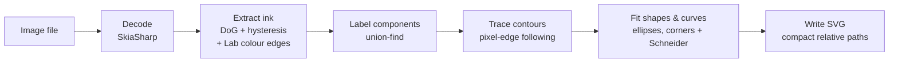

# SvgCreator technical notes

SvgCreator turns a raster image, such as an anime character illustration, into a **line-art SVG**: black ink outlines with no colouring. These pages record the techniques used in the project, why each one was chosen over the alternatives, and the pitfalls hit along the way, with the measurements that drove each decision.

> These pages are generated from [`docs/`](https://github.com/gcl-team/SvgCreator/tree/main/docs) in the repository, which is the source of truth. Edit them there; direct wiki edits are overwritten on the next sync.

## Pipeline

| Stage | Page | Code |
|---|---|---|
| Extract ink | [Line Extraction](Line-Extraction.md), [Colour Edges](Colour-Edges.md) | `src/SvgCreator/Imaging/` |
| Label components | [Connected Components](Connected-Components.md) | `Tracing/ComponentLabeler.cs` |
| Trace contours | [Contour Tracing](Contour-Tracing.md) | `Tracing/ContourTracer.cs` |
| Fit curves | [Curve Fitting](Curve-Fitting.md) | `Fitting/` |
| Recognize circles and ellipses | [Shape Recognition](Shape-Recognition.md) | `Fitting/EllipseFitter.cs` |
| Write SVG | [SVG Output](SVG-Output.md) | `Svg/SvgWriter.cs` |
| Optional stamp / postmark look | [Stamp and Postmark Styles](Stamp-Style.md) | `Svg/SvgStyle.cs`, `Svg/StampFilter.cs`, `Svg/PostmarkCancellation.cs` |

Cross-cutting topics:

- [Native AOT](Native-AOT.md): keeping the library trim- and AOT-safe for AWS Lambda.
- [Licensing and Dependencies](Licensing-and-Dependencies.md): why there's no Potrace and no ImageSharp.
- [Tuning Guide](Tuning-Guide.md): which option to change for which symptom.
- [Debugging Techniques](Debugging-Techniques.md): how we measured instead of guessing.

## Design principles that emerged

1. **Measure before fixing.** Several obvious explanations turned out to be wrong. Probing actual pixel values or filter responses found the real cause each time; see [Debugging Techniques](Debugging-Techniques.md).
2. **Prefer evidence over prediction.** For example, close gaps by following faint lines that really exist in the image (hysteresis) before inventing geometry.
3. **Output is filled shapes, not strokes.** Each ink region is a filled path under `fill-rule="evenodd"`, which keeps the original line weight. Most later choices follow from this.
4. **Everything is O(pixels) over flat arrays.** No reflection and no per-pixel allocation, which suits Native AOT and Lambda.
