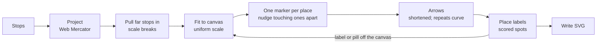

# Travel map

**Goal:** a travel itinerary drawn as a map with no map on it. Imagine a web map of Singapore with only the places you'll visit pinned, straight arrows between them in travel order, and everything else erased. Each place is a marker numbered with its visits, with its name, time and description beside it.

```sh
svgcreator map stops.json -o trip.svg                     # 1024 × 560, white on deep blue
svgcreator map stops.json -o trip.svg --width 1600 --height 1000   # more room, same text size
svgcreator map stops.json -o trip.svg --layout panel      # names on the map, details in a side panel
svgcreator map stops.json -o trip.svg --route lines       # route lines without arrowheads; --route none for markers only
svgcreator map stops.json -o trip.svg --breaks none       # strictly to scale: don't pull far stops in
svgcreator map stops.json -o trip.svg --waypoint-color '#7fdbca'   # waypoints in another colour
svgcreator map stops.json -o print.svg --width 4096 --height 2240 --scale 4   # the default map, 4× larger
svgcreator map stops.json -o trip.svg --background-color '#0b3d2e' --foreground-color '#f5f0e1'
```

The stops file is a JSON array. `time`, `description` (an array of lines) and `waypoint` are optional:

```json
[
  { "sequence": 1, "name": "City Hall", "time": "Day 1 · 9 am",
    "description": ["Meet at Exit B", "Walk the Padang"],
    "latitude": 1.2931, "longitude": 103.8520 },
  { "sequence": 2, "name": "City Hall MRT", "waypoint": true, "time": "Day 1 · 10 am",
    "description": ["North–South Line to Khatib"], "latitude": 1.2932, "longitude": 103.8521 },
  { "sequence": 3, "name": "Singapore Zoo", "time": "Day 1 · 11 am",
    "latitude": 1.4043, "longitude": 103.7930 }
]
```

```csharp
var svg = new TravelMapGenerator().Create(
    [new TravelStop(1, "City Hall", 1.2931, 103.8520) { Time = "Day 1 · 9 am", Description = ["Meet at Exit B"] }],
    new TravelMapOptions());
```

Code: `src/SvgCreator/TravelMapGenerator.cs`, `TravelStop.cs`, `TravelMapOptions.cs` (public API), `src/SvgCreator/Mapping/` (geometry, with `ScaleBreaks.cs` for far stops), `src/SvgCreator/Svg/TravelMapWriter.cs` (layout and drawing), `Svg/ItineraryPanel.cs` (the side panel), `src/SvgCreator.Cli/TravelStopsJson.cs` (the stops file)

## No map, so no map licence

Only the stops' coordinates are used. They're facts, not map data, so there are no tiles, no map API and nothing to license. Everything is drawn: a background, arrows, markers and native `<text>`. Every part has a class (`travel-background`, `travel-arrow` with its `travel-arrow-shaft` and `travel-arrow-head`, `travel-marker`, `travel-label`, `travel-waypoint` and `travel-waypoint-name`, `travel-step` (a waypoint in the panel), `travel-arrow-break` and `travel-distance` for a scale break, `travel-panel`, `travel-panel-divider`, `travel-entry`, and `travel-name`, `travel-time`, `travel-description` on the lines), so an editor can restyle it.

Stops are taken in `sequence` order, whatever order the file lists them in. Sequence numbers must be unique. `time` is printed exactly as given, so it can say anything: `Day 2 · 2 pm`, `Night Safari`. Parsing a date and time would only bring time zones and formats into it.

## Sizes don't grow with the canvas

Text, markers, arrows and margins are fractions of a fixed unit, 560 px times `--scale`, not of the canvas. 560 px is the default canvas's shorter side, so the default map is unchanged. A bigger canvas therefore gives the stops more **room**, not bigger text. That is what a dense trip needs. `--scale` makes everything bigger when that is what's wanted, such as a print at 4× the pixels.

**Lesson: scaling with the canvas hides crowding.** The first version sized everything by the canvas's shorter side, like the [envelope](Envelope.md) and [stamp](Postage-Stamp.md). Those are pictures, where that's right. On a map it meant a 1600 × 1000 canvas drew a crowded trip exactly as crowded as 1024 × 560, only larger.

## Labels or a side panel

| `--layout` | The map shows | Time and description |
|---|---|---|
| `labels` | Each stop's name, time and description beside its marker | On the map |
| `panel` | Each marker's place names | A numbered itinerary beside the map |
| `auto` (default) | `labels` when every label fits without covering an arrow, a marker or another label; otherwise `panel` | |

The panel (`Svg/ItineraryPanel.cs`) takes the right 40% of a landscape canvas or the bottom 45% of a portrait one, behind a faint divider. It lists every stop in travel order, revisits included, each with a number badge like its marker. Its text is 80% of the map's, since it's a reference list. Entries flow down in up to three columns. For each column count, the largest text that fits is found by bisection, which works because smaller text never wraps later. Among the counts within 10% of the largest text, the one that wraps the fewest lines wins, with fewer columns on a tie. Otherwise two narrow columns can beat one at slightly smaller text and break even "Day 1 · 8 am" in two. All the panel's text shrinks evenly, to no less than 30%, when even three columns don't fit.

The map keeps true scale (positions are never bent to make room). A real trip showed why the panel is needed: a day in Shanghai with ten stops within about 15 km of each other and the airport 40 km out. At true scale those ten get a small patch of the map, and paragraphs of metro directions can't fit there at any readable size.

## Pipeline



### Projection and fit

Web Mercator (`Mapping/WebMercator.cs`) is what Google Maps and OpenStreetMap draw with, so stops sit where they would on those maps. North is up. It's conformal: at Singapore's latitude a degree of longitude and a degree of latitude are almost the same length, but in Oslo they aren't, and Mercator keeps local shapes right in both. Latitudes are limited to ±85.05°, where web maps cut the world off into a square.

`Mapping/MapFit.cs` scales the stops' bounding box **uniformly** into the drawing area and centres it, so the geography isn't stretched to fill the canvas. A single stop, or several at one spot, has no extent and goes to the centre. Stops in a line along one axis are scaled by that axis alone.

### Far stops: scale breaks

One far stop can ruin a map. On the Shanghai day, Pudong Airport is 38 km from the middle of a trip whose other ten stops lie within about 12 km, and at true scale those ten got a corner of the canvas. So `Mapping/ScaleBreaks.cs` pulls far stops in, and the legs to them are drawn with a **break**: solid at both ends, so they still leave and arrive in the right directions, dotted in the middle, and labelled with the real distance (`≈ 25 km`, great-circle).

- **Far is relative to the trip.** A stop is far when it lies more than 3× the trip's median distance from its middle. The middle is the coordinate-wise median, which a few far stops can't drag. On the Shanghai day the median is 6 km, so only the airport (38 km) is far; Longyang Road (12 km) stays to scale. A road trip whose stops are all far apart has a large median and breaks nothing.
- **A far stop keeps its direction.** It moves in along the line from the middle, to 1.6× the near stops' reach. The airport still lies east-southeast of the city, just closer.
- **It lands clear of the near stops.** At least 0.8× the reach from every one of them. Without this, the airport landed about 7 km past Longyang Road, which lies the same way, and the broken leg was too short to read.
- **Far stops near each other move together.** Those within the reach of each other (an airport and its hotel) move as one group, so the legs between them stay to scale and unbroken.
- **Legs between groups are broken.** Only those: a long leg between two near stops is drawn to scale.

The distance label sits on the middle of the dots, with a halo of the background colour behind it so the dots don't run through it. When the dotted stretch is too short for that (a small map), the label moves beside the line instead. Label placement avoids it like a marker. `--breaks none` keeps everything strictly to scale.

### Places and waypoints

Most stops on a transit day are where you change trains, not where you're going: on the Shanghai day, seven of eleven are metro stations. Marking a stop `"waypoint": true` makes it a **waypoint**:

| | Place (default) | Waypoint |
|---|---|---|
| On the map | A numbered marker | A small dot with its name in smaller type, like a station on a metro map |
| Numbering | 1, 2, 3… in travel order, counting places only | None |
| The route | Arrives with an arrowhead | Runs through it, joined up: its legs end at the dot's centre, with no head |
| In the panel | A numbered entry | A step under the place before it, indented, with a dot for a badge |
| Least gap beside it | The route style's | At most 0.05 units: its legs have no head to make room for |
| Colour | The foreground (white) | `--waypoint-color`, amber `#ffd166` by default: its dot and name on the map, its step in the panel |

Colour separates the two kinds at a glance, where size alone needs a second look. The route stays in the foreground colour, so it still reads as one line.

A waypoint is chosen explicitly rather than guessed from "Station" in the name, which would misfire on a "Station Road Hotel" and miss a bus stop or a pier. A waypoint and a place with the same name stay apart.

**Lesson: give the space to what the trip is about.** With the airport back, the Shanghai map was cramped, and the culprit wasn't the scale break. The long bilingual names at the western markers overran the map's edge by 207 px, and the map pulled in by all of it: 40% of its width. Moving the panel to the bottom, shrinking the map's names and landing the airport closer all changed little. Turning the stations into dots with one-line names did, because seven of the eleven labels got small.

### Wrapping names

Lines wrap at spaces first: a run of Chinese characters, such as the Chinese half of "Jinshajiang Road Station 金沙江路", moves to the next line whole when it fits there. Only a run wider than a whole line breaks between its characters, and it still starts on a fresh line, so a name's two halves stay apart: "Hanting Hotel" / "汉庭酒店(上海金" / "沙江路地铁站店)".

### One marker per place

Stops with the same name (ignoring case and surrounding spaces) are **one place** visited more than once, such as flying in and out of Changi or returning to the hotel. A place gets one marker, at the mean of its stops' positions, and its badge lists every visit: `1 · 7`, which becomes a pill once it outgrows a circle. Its text is one block, with the name once, then each visit's time and description in travel order, a little space between visits.

Different places never share a marker, however close they are. Markers closer than **0.09 units (50 px at scale 1), outline to outline**, are **nudged apart** (less without arrowheads, see [the route](#the-route-arrows-lines-or-none)). Each moves half the shortfall, along the axis where it is smaller (for pills nearly always vertical, so they stack). The gap is what a visible arrow needs: each end pulls back about 21 px from its marker and the head is 22 px long, so closer neighbours lost the leg between them. A nudge moves a marker only by the shortfall, so distant places stay true to scale, and a dense cluster turns a little schematic, like a metro map.

The gap was chosen by rendering. At 0.06 (34 px) the leg between Marina Bay Sands and Gardens by the Bay still vanished. At 0.12 (67 px) the Shanghai hotel cluster was pushed into a column, with one leg running past another place's marker.

**Lesson: group by meaning, not by distance.** The first version merged stops whose markers were within 3 radii into one pill, `2 · 3`, with their blocks side by side. A real trip broke it. On a day in Shanghai, `3 · 4 · 10` held both Jinshajiang Road Station and the Hanting Hotel next to it, so nothing said which number was which place. The row of names drifted away from its pill. Whether two places merged depended on the zoom, not on the trip. Merging markers that *touched* was worse: each merge widened the pill and moved it, so it caught the next one, and one pill swallowed seven stops spread over 15 km.

### The route: arrows, lines or none

| `--route` | Each leg | Least gap between markers |
|---|---|---|
| `arrows` (default) | An arrow | 0.09 units (50 px): room for a visible head |
| `lines` | A line without a head: the markers' numbers give the direction | 0.05 (28 px) |
| `none` | Nothing: markers and labels alone | 0.03 (17 px) |

The numbers already say the order, so the heads are partly redundant. Lines keep the *shape* of the day (where the hotel is, which legs are out-and-back) with less ink, and their smaller gap leaves clusters closer to true scale. With no route at all, labels have nothing to avoid but each other, so `auto` keeps a dense trip's full text on the map: the Shanghai day fits at 1024 × 560 with no panel. But following the order then means hunting for the next number.

### Arrows

An arrow joins each stop to the next, pulled back to just short of both markers' outlines. A pill's outline is a capsule, so the distance is solved in closed form: `r / |dy|` through the flat sides, the end-cap circle past them. Consecutive visits to the same place get no arrow.

A single leg between two places is straight. Legs between the **same two places** (there and back, or the same trip twice) are quadratic curves instead, each bowing to its own right by 0.06 of its length, and each repeat in the same direction bows that much wider again. Going and coming back bow to opposite sides and form a **lens**, which reads as "out and back" at a glance. A curve leaves and arrives at an angle, so its ends are pulled back along those directions. Label placement and the collision check flatten it into 12 segments.

The first version drew repeats as parallel straight lines 0.05 units apart. Between two pills that read as a ladder, not as a round trip.

**Pitfall: a curved shaft fills.** The arrow was one path, shaft and head, filled so the head is solid. A straight shaft encloses no area, but a curved one does: the region between the curve and its chord filled in, and every round trip drew as a solid white leaf. The shaft and head are now separate paths, and the shaft is `fill="none"`.

The arrowhead is a path of its own rather than an SVG `<marker>`, which some renderers and editors handle inconsistently.

### Label placement

Each marker's label can go in eight spots around it. In order of preference they are below, right, left, above, then the four diagonals. `Mapping/LabelPlacer.cs` scores each spot:

| Covers | Weight |
|---|---|
| An arrow (its length inside the label, with clearance) | × 5 |
| A marker | × 5 |
| Another label | × 10 |
| Off the canvas | × 1 while the map can still shrink |
| Preference | 0–7, so a label with nothing in the way sits below its marker |

Labels are placed greedily in travel order, then refined: each one is placed again knowing where all the others went, until nothing moves. Text aligns toward its marker: right-aligned on its left, left-aligned on its right, centred above or below. Beside a marker, the label's first line is centred on it, as in a hand-drawn itinerary.

**Lesson: weigh what can be fixed later lightly, but not too lightly.** The first weights made running off the canvas expensive. A label at the edge then preferred to sit on an arrow, and moving it back onto the canvas *after* choosing its spot could land it on something else. So running off the canvas is cheap while the map can still make room. If a label or a wide pill overruns an edge, the map pulls in from that edge by the overrun and is laid out again, for up to 8 rounds. The map never goes below half the canvas. At that point each spot is first moved onto the canvas and then scored where it will really be, at 20 per pixel moved.

Too cheap has its own failure. On the busy Singapore trip, "Jurong Bird Park" went 235 px off the left edge rather than cross an arrow. The map pulled in by all of it, the next label ran off the right, and the map ended at half its size. Raising the weight fixed that but broke the simple three-stop map, whose labels then sat on arrows. No single weight suits both, so the map is laid out with a light weight (1) and a heavier one (3). It keeps the result with fewer collisions, and on a tie the larger map.

**Collisions are measured on estimates.** Label bounds come from the deliberately wide width table, so a sliver of overlap is usually nothing on screen. Overlap less than a square of the label gap (about 11 × 11 px) doesn't count, both when shrinking text and when `auto` decides between labels and the panel. Before this, a 10 px corner of "Marina Bay Sands" clipping an arrow shrank all the text to 60% and then moved the details to the panel anyway.

### Text that can't fit

A block wider or taller than the canvas (a long name that can't wrap, say) can't fit at any map scale. All the text then shrinks by the same factor, so names, times and descriptions keep their proportions. The wrap width scales with it, so lines break in the same places. Nudging can change as the map refits, so this takes up to 3 rounds.

Text that fits the canvas can still collide when a trip is dense. The text then shrinks in 10% steps until nothing collides, to no less than 60%; past that it stops being readable. The layout with the fewest collisions wins, and on a tie the one with larger text. Under `auto`, collisions that remain at that point move the details to the panel.

### Wrapping Chinese and Japanese

Lines can also break between any two CJK characters, which Chinese and Japanese break without spaces (see [wrapping names](#wrapping-names) for which break comes first). Without this, a name like `汉庭酒店(上海金沙江路地铁站店)` is one unbreakable word that runs into the next column. Brackets and punctuation stay with the character they belong to, so no line starts with `)`, `：` or `·`, or ends with `(`.

## Text widths, sans-serif

As with the [postage stamp](Postage-Stamp.md#lesson-text-width-without-a-font), the text is native `<text>`, so its width is estimated from a per-character table (`Svg/FontMetrics.cs`, now shared with the stamp). The map's stack is `Helvetica, Arial, sans-serif`. Its table is the widest advance across Helvetica, Helvetica Neue and Arial, regular and bold, measured with Skia at 1000 px.

Linux's generic `sans-serif` is usually DejaVu Sans, a wide face that wasn't installed on the machine that measured the table. **Verdana** was measured in its place: it has the same wide humanist proportions and runs a little wider still. The cost is that on macOS and Windows the real text is narrower than estimated. Lines wrap a little early, and a pill is a little longer than its numbers need. Overestimating leaves space, while underestimating would let text overrun.

## Reading the stops file

`TravelStopsJson` is a System.Text.Json **source-generated** context, so the CLI needs no reflection under [Native AOT](Native-AOT.md). It reads camelCase properties case-insensitively and allows comments and trailing commas.

**Pitfall: a missing property is null, not the default.** `TravelStop` is a positional record. With a constructor to call, System.Text.Json assigns every `init` property, and it assigns the missing ones null, overriding the `= []` default. A stop without `description` failed validation with "description lines can't be null". `Description` now treats null as no lines.
